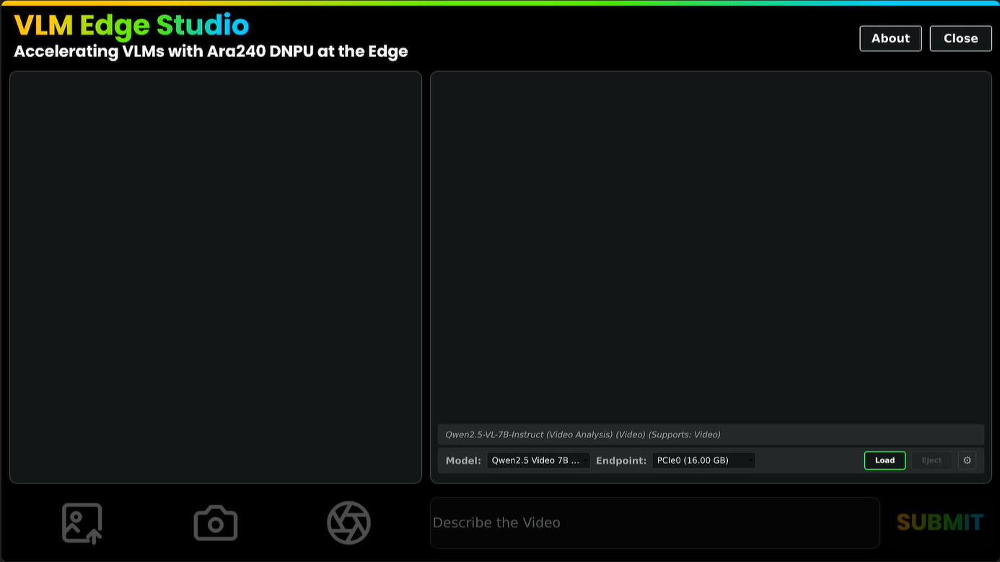
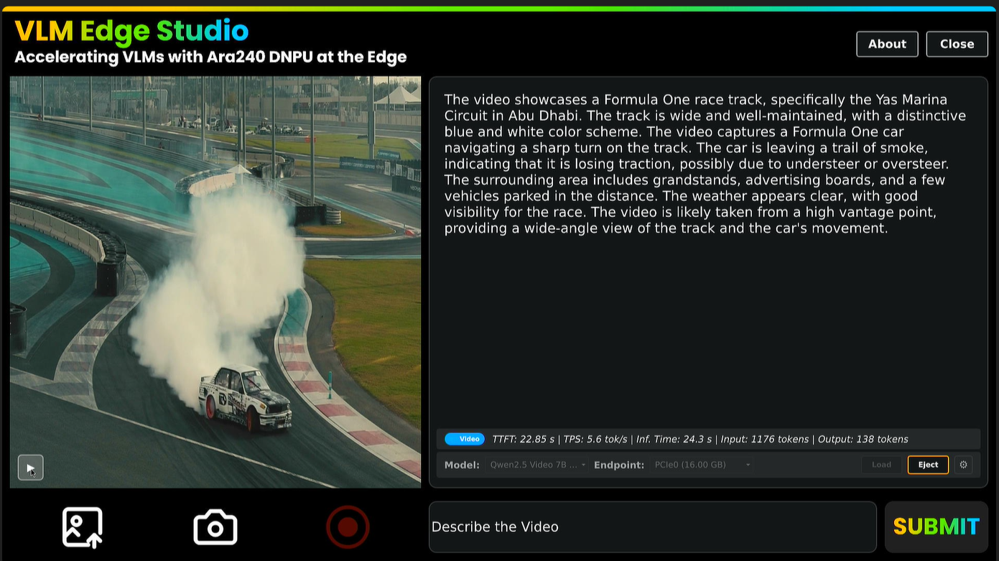

[](https://www.nxp.com)
# VLM Edge Studio

[](./LICENSE)
[](https://www.nxp.com/products/processors-and-microcontrollers/arm-processors/i-mx-applications-processors:IMX_HOME)
[](https://isocpp.org/)
[](https://www.nxp.com/docs/en/user-guide/UG10166.pdf)
[]()
[](https://www.nxp.com/design/design-center/software/embedded-software/i-mx-software/embedded-linux-for-i-mx-applications-processors:IMXLINUX)

Experience real-time video analysis at the edge with **Ara240**, powered by NXP’s **VLM Edge Studio**. This solution delivers instant, text-based descriptions of live video feeds driven by advanced vision-language intelligence. By running *Video Language Models* (VLMs) locally on the NXP **Ara240** *Discrete Neural Processing Unit* (DNPU) it interprets visual events as they happen, ensuring high-performance, low-latency scene understanding without relying on the cloud.
Designed to showcase the performance, scalability, and responsiveness of the **Ara240** architecture, this application demonstrates the power of localized intelligence by executing advanced AI workloads directly at the edge. By leveraging the **Ara240** compute capabilities for high-performance, on-device inference, the system eliminates cloud dependency and drastically reduces latency. The result is real-time, autonomous decision-making engineered for next-generation smart cameras, industrial automation, and intelligent edge ecosystems.  

## Table of Contents
1. [Software](#step1)
2. [Hardware](#step2)
3. [Setup](#step3)
4. [Results](#step4)
5. [FAQs](#step5) 
6. [Support](#step6)
7. [Release Notes](#step7)

## 1. Software<a name="step1"></a>

Introducing **VLM Edge Studio**: the NXP launcher designed for interaction with compatible *Visual Language Models* (VLMs) accelerated by the **Ara240** DNPU at the edge. This application, compatible with **FRDM i.MX 8M Plus**, **FRDM i.MX 95** and  **FRDM i.MX 95 Pro**,  enables rapid interaction with locally running VLMs. It uses the eIQ AAF Connector to communicate with the **Ara240** Runtime SDK and provides a user-friendly GUI for model selection and prompt input.

### 1.1 Software Architecture



VLM Edge Studio provides a simple interface for interacting with locally accelerated Visual Language Models. The media frames and user prompts are sent to the eIQ AAF Connector via HTTP requests.
From there, the requests are handled by the Ara240 Runtime SDK —comprising client libraries, Optimum‑Ara and the Proxy- before reaching the Ara240 hardware over PCIe, where the media frames and the user's prompt are processed by a pre-loaded VLM.
The VLM output is streamed back to the user, along the same path in reverse until it is finally displayed on the GUI; this architecture enables real-time response delivery as the output is generated, ensuring a seamless experience.

### 1.2 Currently supported VLMs

| **Model**           | **Params (billion)** | **TTFT (s)** | **Avg. Token rate (Tokens/seconds)** | **Model Card**                                                                            | **License**                                                                             |
| ------------------- | -------------------- | ------------ | ------- | ----------------------------------------------------------------------------------------- | --------------------------------------------------------------------------------------- |
| Qwen2.5-VL-7B (Video)  | 7B                | 22.85        | 5.6     | [nxp/Qwen2.5-VL-7B-Instruct-Ara240](https://huggingface.co/nxp/Qwen2.5-VL-7B-Instruct-Ara240) | [Apache-2.0](https://huggingface.co/nxp/Qwen2.5-VL-7B-Instruct-Ara240/blob/main/LICENSE) |
| Qwen2.5-VL-7B (Image)  | 7B                | 4.36         | 5.8     | [nxp/Qwen2.5-VL-7B-Instruct-Ara240](https://huggingface.co/nxp/Qwen2.5-VL-7B-Instruct-Ara240) | [Apache-2.0](https://huggingface.co/nxp/Qwen2.5-VL-7B-Instruct-Ara240/blob/main/LICENSE) |

> **Note:**\
> **TTFT:** - Time to first token (TTFT). Reported as a range: the lower bound corresponds to prompts up to 128 tokens, and the upper bound reflects prompts at maximum context length.\
> **Avg. Token Rate:** Average token rate over the context length.

## 2. Hardware<a name="step2"></a>
### 2.1 Supported Platforms

| Platform                                                                                                    | Supported |
| ----------------------------------------------------------------------------------------------------------- | :-------: |
| [FRDM i.MX 8M Plus](https://www.nxp.com/design/design-center/development-boards-and-designs/FRDM-IMX8MPLUS) |     ✅     |
| [FRDM i.MX 95](https://www.nxp.com/design/design-center/development-boards-and-designs/FRDM-IMX95)          |     ✅     |
| [FRDM i.MX 95 Pro](https://www.nxp.com/design/design-center/development-boards-and-designs/FRDM-IMX95-PRO)  |     ✅     |

### 2.2 Required hardware

- Supported FRDM i.MX platform
- microSD card (recommended size >=64 GB)
- [Ara240 16GB M.2 Module](https://www.nxp.com/design/design-center/development-boards-and-designs/ARA2-M2-16G-GT)
- USB-C power supply (5V/3A recommended)
- 1920x1080 HDMI display monitor
- 1920x1080 USB camera
- HDMI cable
- USB mouse and keyboard
- Two USB-C to USB-A debug cables
- USB hub

## 3. Setup<a name="step3"></a>

Since **VLM Edge Studio** is already part of i.MX Linux BSP, you can simply download a pre-built BSP image from NXP's Official website and flash it to your FRDM i.MX board to install it.
The detailed steps for testing this application are provided below.

### 3.1 Installation

1. Download the Linux i.MX image (version 6.18.20_2.0.0 or greater) corresponding to your FRDM i.MX board from [Embedded Linux for i.MX](https://www.nxp.com/design/design-center/software/embedded-software/i-mx-software/embedded-linux-for-i-mx-applications-processors:IMXLINUX). 
2. Download the [Universal Update Utility](https://github.com/nxp-imx/mfgtools) (release version 1.5.243 or latest).
3. Configure the Boot Switch on the FRDM board to *serial downloader* mode (make sure the board is turned off), please refer to the Quick Start Guide corresponding to yout FRDM i.MX board for this step:
	- [FRDM i.MX 8M Plus Quick Start Guide](https://www.nxp.com/docs/en/quick-reference-guide/FRDMIMX8MPLUSQSG.pdf)
	- [FRDM i.MX 95 Quick Start Guide](https://www.nxp.com/docs/en/quick-reference-guide/FRDMIMX95QSG.pdf)
	- [FRDM i.MX 95 Pro Quick Start Guide](https://www.nxp.com/docs/en/user-guide/FRDMIMX95PROQSG.pdf)
4. Insert the SD card in the FRDM i.MX board.
5. Connect your FRDM i.MX board to the power supply and connect its USB-C and DEBUG ports to your host machine.
6. Open a terminal in your host machine and run the Universal Update Utility using the following command along with the `.bin-flash` file and the `.wic` image corresponding to your FRDM i.MX board:
	```bash
	.\uuu.exe -b sd_all <imx-boot-*.bin-flash> <imx-image-full-*.wic>
	```
7. Power on the FRDM i.MX board and wait for the flashing process to complete.

### 3.2 Running VLM Edge Studio

This application is already available in NXP's [GoPoint for i.MX Applications Processors](https://www.nxp.com/design/design-center/software/i-mx-developer-resources/gopoint-for-i-mx-applications-processors:GOPOINT) launcher, to run it follow the next steps:
1. Connect the HDMI display, USB camera, keyboard and mouse to your FRDM i.MX board (a USB hub might be needed). 
2. Configure the Boot Switch on the FRDM board to *USDHC2 4-bit SD3.0* mode (make sure the board is turned off).
3. Connect the **Ara240 16GB M.2 Module** to the FRDM i.MX board.
4. Power on the FRDM i.MX board and wait for the boot process to complete.
5. Connect the FRDM i.MX board to the internet, for detailed information about Wi-Fi or Ethernet connectivity please refer to [i.MX Linux User's Guide](https://www.nxp.com/docs/en/user-guide/UG10163.pdf) chapter 11.
6. Once the boot process is completed click the **GoPoint** icon that appears in the upper left corner of the screen.
7. Navigate inside **GoPoint** interface and select **VLM Edge Studio**, then click the **Launch Demo** button.

## 4. Results<a name="step4"></a>
Once the launcher is shown on screen, click the `Load` button. The model will start loading; once ready, you can type a prompt and click Submit.

<center>
<br>
<br><i>Figure 1. VLM Edge Studio.</i>
</center>

### 4.1 Model Configuration

VLM generation parameters can be adjusted at any time without reloading the model. Click the **gear icon (⚙)** in the model selector bar to open the **Model Configuration** pop-up.

<center>
<br>
<br><i>Figure 2. Gear button used to open the Model Configuration pop-up.</i>
</center>

<center>
<br>
<br><i>Figure 3. Model Configuration pop-up with stepper controls.</i>
</center>

### 4.2 Parameters

| Parameter | Range | Step | Description |
|---|---|---|---|
| **Max Tokens** | 1 – 4096 | 1 | Maximum number of tokens the model will generate per response. |
| **Temperature** | 0.0 – 1.0 | 0.1 | Controls output randomness. Lower values produce more focused and deterministic responses; higher values increase creativity and diversity. |
| **Top K** | 0 – 100 | 1 | Limits sampling to the K most probable next tokens. Set to `0` to disable. |
| **Top P** | 0.0 – 1.0 | 0.1 | Nucleus sampling threshold. Only tokens whose cumulative probability reaches this value are considered. |

### 4.3 Controls

- **Text field** — you can type a value directly or use `[<]` / `[>]` stepper buttons to increment or decrement the value.
- **Reset** — restores all fields to the default values for the currently selected model. Defaults are read from `server_config.json` at startup and overlaid with per-model values from `generation_config.json` when a model is selected. When a model is ejected, the parameters return to the global `server_config.json` baseline.
- **Apply** — commits the current values to the backend. The button is disabled until all four fields contain valid values. Changes will take effect on the next prompt submission.


### 4.4 Image & Video Analysis Modes

VLM Edge Studio supports two analysis modes, driven by the capabilities of the loaded model.

The active mode is color-coded throughout the UI for quick visual feedback:

- **Image mode** — green (`#4CAF50`)
- **Video mode** — blue (`#2196F3`)

The media loading progress bar adopts the active mode color, and the **Capture** button icon is mode-aware (a shutter/aperture icon for image capture, a red record dot for video recording).

With Qwen2.5-VL-7B loaded, the model can analyze both still images and video clips, responding to prompts about the captured or loaded media.

<center>
<br>
<br><i>Figure 4. Image analysis mode (Qwen2.5-VL-7B).</i>
</center>

<center>
<br>
<br><i>Figure 5. Video analysis mode (Qwen2.5-VL-7B).</i>
</center>

 <div align="center">
    <br></br>
   <figure>
     
   </figure>
 </div>
 <div align="center">
   <em> Preview 1. Demonstration of VLM Edge Studio providing a detailed description of a video scene using Qwen2.5 Video 7B Instruct model. </em>
   <br></br>
</div>

### 4.5 Media input sources

Each mode accepts media from two sources:

1. **File** — click the **Open** button to browse for media. The file dialog opens the folder that matches the active mode:
   - Image mode: `/usr/share/vlm-edge-studio/assets/images` (`*.jpg`, `*.jpeg`)
   - Video mode: `/usr/share/vlm-edge-studio/assets/videos` (`*.mp4`)
2. **Camera** — click the **Camera** button to start the live USB camera stream, then use the **Capture** button:
   - In image mode, Capture grabs the current frame as a still image.
   - In video mode, Capture records a short clip.

### 4.6 Captured media naming

Camera captures are written to the mode's asset folder with a consistent, timestamped name so recordings are preserved and never overwritten:

- Image frames: `capture_<YYYYMMDD_hhmmss>.jpg`
- Video recordings: `capture_<YYYYMMDD_hhmmss>.mp4`

> **NOTE:** Switching between Image and Video mode clears the current output and reloads the last media used for that mode (falling back to the default asset if none was loaded). It does not reload the model.

## 5. FAQs<a name="step5"></a>
### 5.1 Limitations


A single instance of the program **cannot run multiple models simultaneously across different endpoints**. Model selection is limited to one per instance, regardless of the number of endpoints available.


### 5.2 UI not rendered correctly in higher resolution monitors

The application has been designed for 1920x1080 (FHD) resolution and has not yet been updated to support higher resolutions. Since it lacks dynamic resizing, certain UI elements may appear misaligned. As a workaround you can force Weston to use FHD by modifying the `/etc/xdg/weston.ini` script and restart the Weston service:

```plain
[output]
#name=HDMI-A-1
mode=1920x1080@60
#transform=rotate-90
```

### 5.3 Board Reboots Running Inference

If your board reboots when submitting a prompt for inference, the issue may be related to insufficient power supply Ensure that the power source you're using is the correct one.

> **WARN:** Using a lower-rated power supply may cause system instability or unexpected reboots during high-load operations such as inference.

### 5.4 Roadmap

Support for running multiple models on separate endpoints within a single instance is under consideration for future releases. This enhancement would enable more flexible and scalable deployments, especially in multi-endpoint environments.


## 6. Support<a name="step6"></a>

#### Project Metadata

<!----- Boards ----->
[]()
[]()
[]()

<!----- Categories ----->
[](https://mcuxpresso.nxp.com/appcodehub?category=aiml)
[](https://mcuxpresso.nxp.com/appcodehub?category=ui)
[](https://mcuxpresso.nxp.com/appcodehub?category=vision)

<!----- Peripherals ----->
[](https://mcuxpresso.nxp.com/appcodehub?peripheral=display)
[](https://mcuxpresso.nxp.com/appcodehub?peripheral=hdmi)

<!----- Toolchains ----->
[](https://mcuxpresso.nxp.com/appcodehub?toolchain=gcc)

Questions regarding the content/correctness of this example can be entered as Issues within this GitHub repository.

>**Note**: For more general technical questions regarding NXP Microcontrollers and the difference in expected functionality, enter your questions on the [NXP Community Forum](https://community.nxp.com/)

[](https://www.youtube.com/NXP_Semiconductors)
[](https://www.linkedin.com/company/nxp-semiconductors)
[](https://www.facebook.com/nxpsemi/)
[](https://x.com/NXP)

## 7. Release Notes<a name="step7"></a>
| Version | Description / Update                           | Date                        |
|:-------:|------------------------------------------------|----------------------------:|
| 1.0     | Initial release on Application Code Hub        | September 30<sup>th</sup> 2026 |

## ⚖️ Licensing

This repository is licensed under the [LA_OPT_Online Code Hosting NXP_Software_License](./LICENSE.txt) license.
