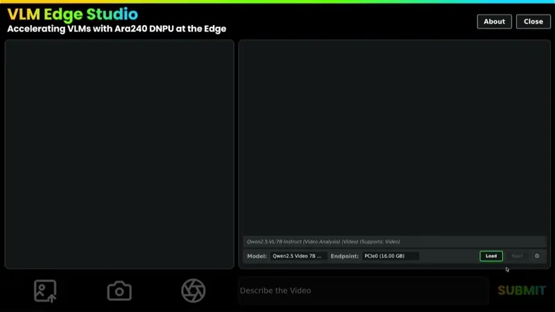
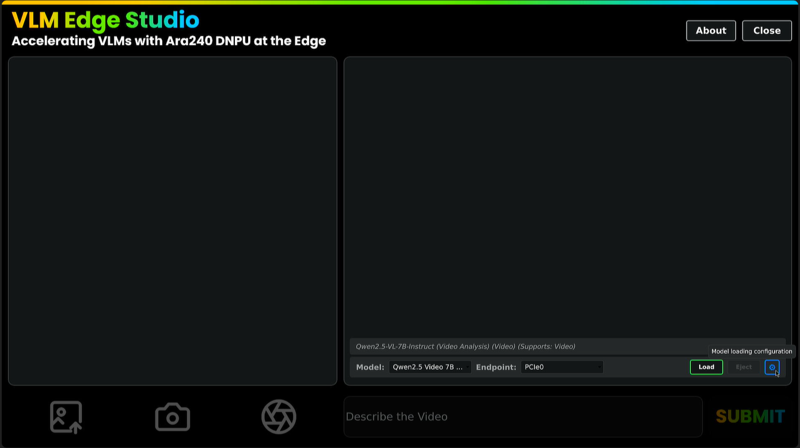
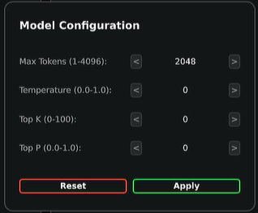
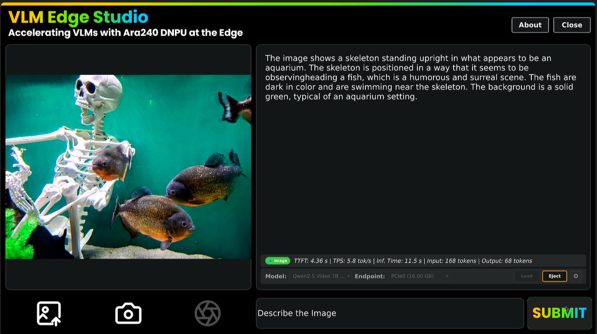

<div align="center">

# VLM Edge Studio 🚀

[](./LICENSE)
[](https://www.nxp.com/products/processors-and-microcontrollers/arm-processors/i-mx-applications-processors:IMX_HOME)
[](https://isocpp.org/)
[](https://www.nxp.com/docs/en/user-guide/UG10166.pdf)
[]()
[](https://www.nxp.com/design/design-center/software/embedded-software/i-mx-software/embedded-linux-for-i-mx-applications-processors:IMXLINUX)

---

</div>

## 🔎 Overview

Experience real-time video analysis at the edge with **Ara240**, powered by NXP’s **VLM Edge Studio**. This solution delivers instant, text-based descriptions of live video feeds driven by advanced vision-language intelligence. By running *Video Language Models* (VLMs) locally on the NXP **Ara240** *Discrete Neural Processing Unit* (DNPU) it interprets visual events as they happen, ensuring high-performance, low-latency scene understanding without relying on the cloud.
Designed to showcase the performance, scalability, and responsiveness of the **Ara240** architecture, this application demonstrates the power of localized intelligence by executing advanced AI workloads directly at the edge. By leveraging the **Ara240** compute capabilities for high-performance, on-device inference, the system eliminates cloud dependency and drastically reduces latency. The result is real-time, autonomous decision-making engineered for next-generation smart cameras, industrial automation, and intelligent edge ecosystems.  

 <div align="center">
    <br></br>
   <figure>
     
   </figure>
 </div>
 <div align="center">
   <em> Preview 1. Demonstration of VLM Edge Studio providing a detailed description of a video scene using Qwen2.5 Video 7B Instruct model. </em>
   <br></br>
</div>

##  📋 Features

Introducing **VLM Edge Studio**: the NXP launcher designed for interaction with compatible *Visual Language Models* (VLMs) accelerated by the **Ara240** DNPU at the edge. This application, compatible with **FRDM i.MX 95** and **FRDM i.MX 8M Plus**, enables rapid interaction with locally running VLMs. It uses the eIQ AAF Connector to communicate with the **Ara240** Runtime SDK and provides a user-friendly GUI for model selection and prompt input.

## Software Architecture


## 💻 Supported Platforms

| Platform                                                                                                    | Supported |
| ----------------------------------------------------------------------------------------------------------- | :-------: |
| [FRDM i.MX 8M Plus](https://www.nxp.com/design/design-center/development-boards-and-designs/FRDM-IMX8MPLUS) |     ✅     |
| [FRDM i.MX 95](https://www.nxp.com/design/design-center/development-boards-and-designs/FRDM-IMX95)          |     ✅     |
| [FRDM i.MX 95 PRO](https://www.nxp.com/design/design-center/development-boards-and-designs/FRDM-IMX95-PRO)  |     ✅     |

## 📋 Requirements

### Required hardware 🧰

- Supported FRDM i.MX platform
- microSD (recommended >=64 GB)
- Ara240 DNPU
- Power supply (5V/3A recommended)
- 1920x1080 Display monitor
- HDMI cable
- USB Mouse & Keyboard
- USB-C debug cable
- USB-C HD Camera (1920x1080 @ 30fps recommended)
- Internet (For Model installation)

### 💻 Software

- Ara240 Runtime SDK installed on target
- [Embedded Linux for i.MX](https://www.nxp.com/design/design-center/software/embedded-software/i-mx-software/embedded-linux-for-i-mx-applications-processors:IMXLINUX) (>= LF6.18.20_2.0.0)
- eIQ AAF Connector v2.1.0
- `nxp/Qwen2.5-VL-7B-Instruct-Ara240` (model.dvm)
- [vlm-edge-studio.deb](https://www.nxp.com/webapp/sps/download/license.jsp?colCode=VLM-EDGE-STUDIO_1.0.0&appType=file1&DOWNLOAD_ID=null) (optional, build instructions available in this repository)

## 🧠 Currently supported VLMs

| **Model**           | **Params (billion)** | **TTFT (s)** | **Avg. Token rate (Tokens/seconds)** | **Model Card**                                                                            | **License**                                                                             |
| ------------------- | -------------------- | ------------ | ------- | ----------------------------------------------------------------------------------------- | --------------------------------------------------------------------------------------- |
| Qwen2.5-VL-7B (Video)  | 7B                | 22.85        | 5.6     | [nxp/Qwen2.5-VL-7B-Instruct-Ara240](https://huggingface.co/nxp/Qwen2.5-VL-7B-Instruct-Ara240) | [Apache-2.0](https://huggingface.co/nxp/Qwen2.5-VL-7B-Instruct-Ara240/blob/main/LICENSE) |
| Qwen2.5-VL-7B (Image)  | 7B                | 4.36         | 5.8     | [nxp/Qwen2.5-VL-7B-Instruct-Ara240](https://huggingface.co/nxp/Qwen2.5-VL-7B-Instruct-Ara240) | [Apache-2.0](https://huggingface.co/nxp/Qwen2.5-VL-7B-Instruct-Ara240/blob/main/LICENSE) |

> **Note:**\
> **TTFT:** - Time to first token (TTFT). Reported as a range: the lower bound corresponds to prompts up to 128 tokens, and the upper bound reflects prompts at maximum context length.\
> **Avg. Token Rate:** Average token rate over the context length.

## ⚙️ Build `vlm-edge-studio.deb` package

1. Clone the repository on your host PC:

    ```bash
    git clone https://github.com/nxp-imx-support/vlm-edge-studio.git
    ```

2. Change directory to the repository and run the following command. Make sure you have the NXP toolchain installed for the FRDM BSP version you need. Steps to build the toolchain are available at [iMX Linux User's Guide](https://www.nxp.com/docs/en/user-guide/UG10163.pdf).

    ```bash
    bash build.sh <path_to_your_toolchain>
    ```

## 🧰 Installation on i.MX

**NOTE:** Make sure the Ara240 Runtime SDK is installed in the FRDM i.MX system before moving forward.

1. Copy the `vlm-edge-studio.deb` to the FRDM i.MX board:

   ```bash
   scp vlm-edge-studio.deb root@<ip_addr>:
   ```

2. Install the package with the following command. This will take a couple of minutes mainly because models need to be extracted:

   ```bash
   dpkg -i vlm-edge-studio.deb
   ```

**NOTE:** If you downloaded the pre-built `.deb` package from NXP.COM, the package name will includes the version. Use the actual package name in the command above. `dpkg -i vlm-edge-studio-<version>.deb`.


## 🚀 Run VLM Edge Studio

1. Run the following command:

    ```
    run_vlm_edge_studio
    ```

    > **NOTE:** Make sure Ara240's runtime service is up and running. You can check with this command: `systemctl status rt-sdk-ara2.service --no-pager -l`

2. Once the launcher is showed on screen.

<center>
<br>
<br><i>Figure 1. VLM Edge Studio.</i>
</center>

## ⚙️ Model Configuration

VLM generation parameters can be adjusted at any time without reloading the model. Click the **gear icon (⚙)** in the model selector bar to open the **Model Configuration** popup.

<center>
<br>
<br><i>Figure 2. Gear button used to open the Model Configuration popup.</i>
</center>

<center>
<br>
<br><i>Figure 3. Model Configuration popup with stepper controls.</i>
</center>

### Parameters

| Parameter | Range | Step | Description |
|---|---|---|---|
| **Max Tokens** | 1 – 4096 | 1 | Maximum number of tokens the model will generate per response. |
| **Temperature** | 0.0 – 1.0 | 0.1 | Controls output randomness. Lower values produce more focused and deterministic responses; higher values increase creativity and diversity. |
| **Top K** | 0 – 100 | 1 | Limits sampling to the K most probable next tokens. Set to `0` to disable. |
| **Top P** | 0.0 – 1.0 | 0.1 | Nucleus sampling threshold. Only tokens whose cumulative probability reaches this value are considered. |

### Controls

- **Text field** — you can type a value directly or use `[<]` / `[>]` stepper buttons to increment or decrement the value.
- **Reset** — restores all fields to the default values for the currently selected model. Defaults are read from `server_config.json` at startup and overlaid with per-model values from `generation_config.json` when a model is selected. When a model is ejected, the parameters return to the global `server_config.json` baseline.
- **Apply** — commits the current values to the backend. The button is disabled until all four fields contain valid values. Changes will take effect on the next prompt submission.


## 🖼️ Image & Video Analysis Modes

VLM Edge Studio supports two analysis modes, driven by the capabilities of the loaded model.

The active mode is color-coded throughout the UI for quick visual feedback:

- **Image mode** — green (`#4CAF50`)
- **Video mode** — blue (`#2196F3`)

The media loading progress bar adopts the active mode color, and the **Capture** button icon is mode-aware (a shutter/aperture icon for image capture, a red record dot for video recording).

With Qwen2.5-VL-7B loaded, the model can analyze both still images and video clips, responding to prompts about the captured or loaded media.

<center>
<br>
<br><i>Figure 4. Image analysis mode (Qwen2.5-VL-7B).</i>
</center>

<center>
<br>
<br><i>Figure 5. Video analysis mode (Qwen2.5-VL-7B).</i>
</center>

### Media input sources

Each mode accepts media from two sources:

1. **File** — click the **Open** button to browse for media. The file dialog opens the folder that matches the active mode:
   - Image mode: `/usr/share/vlm-edge-studio/assets/images` (`*.jpg`, `*.jpeg`)
   - Video mode: `/usr/share/vlm-edge-studio/assets/videos` (`*.mp4`)
2. **Camera** — click the **Camera** button to start the live USB camera stream, then use the **Capture** button:
   - In image mode, Capture grabs the current frame as a still image.
   - In video mode, Capture records a short clip.

### Captured media naming

Camera captures are written to the mode's asset folder with a consistent, timestamped name so recordings are preserved and never overwritten:

- Image frames: `capture_<YYYYMMDD_hhmmss>.jpg`
- Video recordings: `capture_<YYYYMMDD_hhmmss>.mp4`

> **NOTE:** Switching between Image and Video mode clears the current output and reloads the last media used for that mode (falling back to the default asset if none was loaded). It does not reload the model.

## Limitations


A single instance of the program **cannot run multiple models simultaneously across different endpoints**. Model selection is limited to one per instance, regardless of the number of endpoints available.


### UI not rendered correctly in higher resolution monitors

The application has been designed for 1920x1080 (FHD) resolution and has not yet been updated to support higher resolutions. Since it lacks dynamic resizing, certain UI elements may appear misaligned. As a workaround you can force Weston to use FHD by modifying the `/etc/xdg/weston.ini` script and restart the Weston service:

```plain
[output]
#name=HDMI-A-1
mode=1920x1080@60
#transform=rotate-90
```

### Board Reboots Running Inference

If your board reboots when submitting a prompt for inference, the issue may be related to insufficient power supply Ensure that the power source you're using is the correct one.

> **WARN:** Using a lower-rated power supply may cause system instability or unexpected reboots during high-load operations such as inference.

---

## 🛣️ Roadmap

Support for running multiple models on separate endpoints within a single instance is under consideration for future releases. This enhancement would enable more flexible and scalable deployments, especially in multi-endpoint environments.


## ⚖️ Licensing

This repository is licensed under the [LA_OPT_Online Code Hosting NXP_Software_License](./LICENSE.txt) license.
